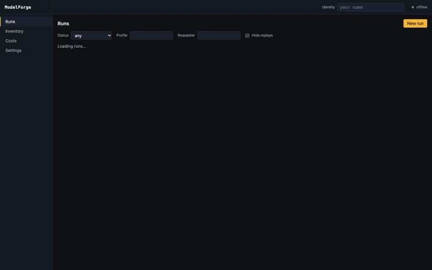
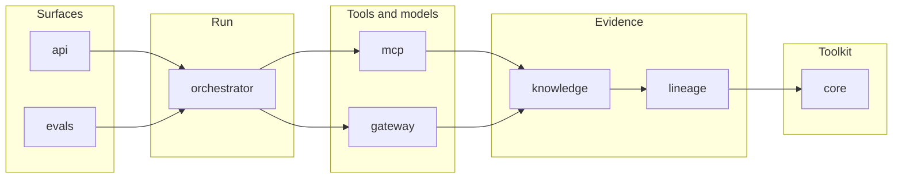
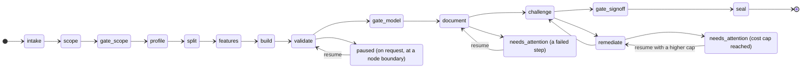

# ModelForge

ModelForge is a governed, multi-agent copilot for the credit risk model development lifecycle. Given a raw credit dataset and a modeling brief, it produces a validated probability-of-default (PD) model, an SR 11-7 style model development document, an independent "effective challenge" review, a tamper-evident audit trail and a model inventory entry, with human approval gates at the points where a bank would require them. SR 11-7 (2011) shaped its pipeline and its document template; SR 26-2 (17 April 2026) superseded SR 11-7 and SR 21-8 and places generative and agentic AI outside its scope, which leaves agentic systems in a governance gap. ModelForge shows what effective challenge, lineage and human accountability look like when they are applied to an agentic system anyway. A reviewer will see a deterministic scorecard pipeline driven by agents through MCP servers, three human gates with a four-eyes rule, a challenger that cannot see the developer's reasoning, a hash-chained lineage store, byte-for-byte replay, and an eval harness that measures all of it. It is a reference implementation, not a production system.

[](https://github.com/adityaparab/model-forge/actions/workflows/ci.yml)
[](LICENSE)



The recording above is the real console on the `fake` profile. [The walkthrough](docs/walkthrough.md) goes through the same run step by step with a screenshot each; the full-resolution [video](docs/media/demo.mp4) is in `docs/media/`.

## Try it

Prerequisites: Docker with Compose v2, `make`, `curl` and `python3` on the host; nothing else, and no model key.

```bash
git clone https://github.com/adityaparab/model-forge.git
cd model-forge
make demo        # Docker Compose: Postgres, Jaeger, Phoenix, the API and the worker, plus one demo run
```

`make demo` builds the image, starts the five services, submits `examples/briefs/polish-pd.yaml` under the `fake` profile as `alice` and prints the run's console URL. Within minutes the run is visible in the console at `http://localhost:8000`, paused at the first gate. Type `alice` in the top bar and approve the scope gate, then switch the identity to `bob` to accept the model and approve the sign-off: the `model` and `signoff` decisions must come from someone other than the requester. Once the run is sealed, the worker replays it and the Overview shows the reproducibility badge. `make down` stops the stack.

| What | Where |
| --- | --- |
| Console | `http://localhost:8000` |
| API documentation (OpenAPI) | `http://localhost:8000/docs` |
| Jaeger | `http://localhost:16686` |
| Phoenix | `http://localhost:6006` |

The [Compose reference](docs/reference/compose.md) has the rest, and [commands](docs/reference/commands.md) lists the targets for working on the code (`make sync`, `make lint test`, `make example`).

## How it works

Eight Python packages in a uv workspace, layered so that each imports only from the layers below it. import-linter enforces the direction in CI, and the `core` contracts keep it free of any model or network dependency.



- `core` is the deterministic, LLM-free toolkit: profiling and leakage screening, train / validation / out-of-time splits, monotone WoE binning, a WoE logistic scorecard champion with a LightGBM challenger, calibration and thirteen validation tests.
- `lineage` stores every artifact by content hash and every step, tool call and decision as an event in a hash-chained Postgres log; a sealed run has a manifest that `verify` checks.
- `knowledge` is the retrieval corpus (regulatory and methodology passages) that every regulatory claim in the document must cite.
- `gateway` is the only way to a model: routing per purpose, schema-checked output, prompt versioning, redaction, cost accounting and the cost cap.
- `mcp` exposes the toolkit and the knowledge layer as MCP servers; the agents never call `core` directly.
- `orchestrator` is the LangGraph run, the agents, the gates and the worker; `evals` is the harness that scores runs; `api` is the HTTP API and serves the console.

A run is a fixed graph of fourteen nodes. Four of them call a model through the gateway (`scope`, `document`, `challenge` and `remediate`); the rest are deterministic. The run stops at three human gates, and the challenge and remediation loop is bounded.



The side states apply to any node, not only the ones drawn: a pause request parks a running run before its next node, a failed tool or model call parks it in `needs_attention`, and a run that reaches its cost cap parks there too until it is resumed with a higher cap. `resume` continues from the last checkpoint and `abort` ends the run. The [run reference](docs/reference/run.md) has the gate decisions, the statuses and replay.

## What it demonstrates

- **Human accountability.** Three gates; the `model` and `signoff` decisions must come from someone other than the requester, and `approve` at sign-off is refused while a critical or high finding is open. Proof: [`packages/api/tests/test_writes.py`](packages/api/tests/test_writes.py), and the [design memo](docs/design-memo.md) for every control.
- **Traceable numbers.** Every number in the development document traces to a hashed artifact and every regulatory claim to a knowledge passage, or the section is flagged. Proof: [`packages/orchestrator/tests/test_grounding.py`](packages/orchestrator/tests/test_grounding.py).
- **Effective challenge.** The challenger is structurally isolated from the developer agent: it reads the rendered document, validation excerpts, the recorded plan and its own retrieved passages, never the brief, the scope notes or the drafts. Proof: [`packages/orchestrator/tests/test_challenger_isolation.py`](packages/orchestrator/tests/test_challenger_isolation.py), and the [challenger reference](docs/reference/challenger.md).
- **Reproducibility and tamper evidence.** A replay of a sealed run yields byte-identical hashes for every deterministic artifact, and `verify` fails on any altered event or artifact. Proof: [`packages/orchestrator/tests/test_integration.py`](packages/orchestrator/tests/test_integration.py) and [`packages/lineage/tests/test_verify.py`](packages/lineage/tests/test_verify.py).
- **Measured quality.** The eval harness runs offline in CI on every pull request and against a hosted model on `main`, and fails on regressions in document quality, challenger recall, retrieval recall or cost. Proof: [`.github/workflows/ci.yml`](.github/workflows/ci.yml), [`.github/workflows/evals.yml`](.github/workflows/evals.yml) and the [evals reference](docs/reference/evals.md).
- **A local model, measured honestly.** The same pipeline runs against a local model through Ollama, and the gap to the hosted model is published below from the recorded runs. Proof: [`docs/results/runs.json`](docs/results/runs.json) and the [trade-offs](docs/trade-offs.md).

## Measured

Every number here is rendered by `make results` from [`docs/results/runs.json`](docs/results/README.md), which a script writes from the runs' eval reports and lineage; none is typed by hand.

<!-- results:parity -->
| Profile | Model | Status | Grounding | Complete | Ungrounded numbers | Findings (pre-check / review; critical / high / medium / low) | Rounds (challenge / remediation) | Sections regenerated | Schema retries | LLM calls | Cost USD | Wall time |
| --- | --- | --- | --- | --- | --- | --- | --- | --- | --- | --- | --- | --- |
| hosted-default | anthropic/claude-opus-5-5 | completed, approve_with_conditions | 100.0% | yes (0 flagged) | 0 | 0 / 11; 0 / 4 / 7 / 0 | 3 / 2 | 7 | 0 | 92 | 7.18 | 31:02 |
| hosted-ci-cheap | anthropic/claude-sonnet-5-5 | completed, approve_with_conditions | 81.8% | no (2 flagged) | 1 | 9 / 7; 0 / 12 / 4 / 0 | 3 / 2 | 11 | 0 | 139 | 3.19 | 11:34 |
| local-ollama | ollama/gpt-oss:20b | needs_attention, n/a | - | - | - | 10 / 7; 2 / 14 / 1 / 0 | 1 / 0 | - | 10 | 67 | 0 (local) | 28:59 |
<!-- /results:parity -->

Both hosted runs completed and sealed with a conditional sign-off, and the default run reproduced on replay. The local `gpt-oss:20b` run got through the document and the challenger but failed remediation on a schema error after its retries and parked in `needs_attention`, so its eval-only columns are `-`; the schema-retry and call columns show how often the local model missed the schema.

## Read next

The [documentation index](docs/index.md) gives the reading order with times:

1. This README.
2. [The walkthrough](docs/walkthrough.md): the demo run, one screenshot per step.
3. [The design memo](docs/design-memo.md): the model, the agents and the controls, for a model-risk reviewer.
4. [The domain primer](docs/domain-primer.md): credit risk and model risk management for an engineer.
5. [The threat model](docs/threat-model.md): trust boundaries, threats and residual risks.
6. [The trade-offs](docs/trade-offs.md): where a model is used, where it is not, and what each choice cost.

The [reference pages](docs/index.md#reference) hold the detail that used to live in this README: the CLI, the console, the API, tracing, the MCP servers, the gateway, the knowledge layer, the challenger, the remediation loop, evals, live models, Compose, configuration, commands and datasets.

## Not a production system

- **Identity is a header, not authentication.** Every write names its actor in `X-ModelForge-User`, and anyone who reaches the API can send any name; the four-eyes rule is only as strong as that.
- **The data are proxies.** The datasets are corporate bankruptcy data, not retail credit data: bankruptcy stands in for default and the Polish horizon files stand in for vintages ([datasets](docs/reference/datasets.md)).
- **Local model quality.** The local run above did not finish; a local model is a supported route, not an equivalent one.
- **No monitoring.** There is no ongoing performance monitoring, no worker lease (a dead worker leaves a run `running`) and no model or prompt change control beyond what lineage records.

## Status

Sub-projects 1 to 5 are complete: the core toolkit; the governed orchestrator with its lineage store and MCP servers; the LLM gateway, knowledge layer and agents; the challenger, the remediation loop and the eval harness; and the API, the console and `make demo`. Sub-project 6, this documentation with its measurements and the demo recording, is in progress. How it was built, spec by spec and plan by plan, is under [`docs/superpowers/`](docs/index.md#how-it-was-built).

## License

[MIT](LICENSE).
