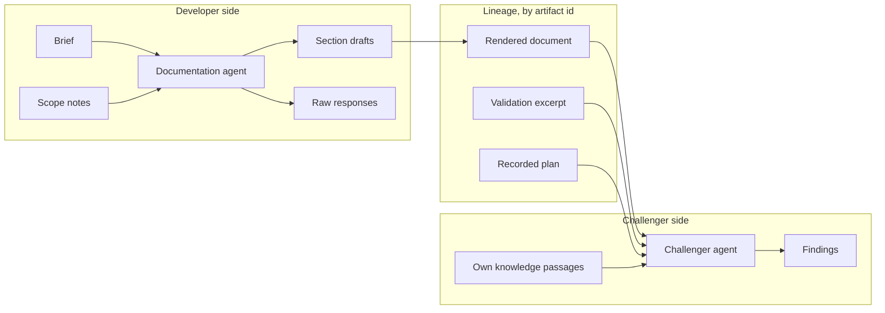
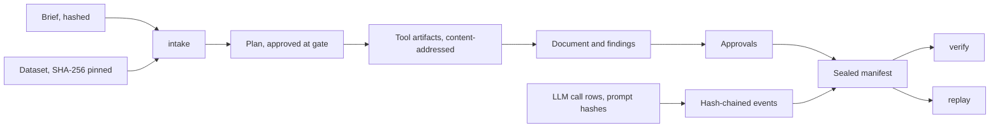

# Design memo

This memo is written for a model-risk reviewer. It states what ModelForge builds, which parts of it are the model under review and which are tooling around the model, why each step of the pipeline is deterministic or delegated to a language model, and which control backs each claim, with the test or contract that proves it. ModelForge is a reference implementation, not a production system: the last sections list what it does not do and what a bank would have to change before it could rely on it.

The [README](../README.md) is the front door and the [walkthrough](walkthrough.md) shows one run screen by screen. This memo does not repeat either; it argues the design.

## Purpose and intended use

ModelForge takes a modeling brief and a tabular credit dataset whose obligors are companies, and produces a probability-of-default (PD) model with the evidence a second-line reviewer would ask for: a model development document, an independent challenge of that document, a hash-chained audit trail, a sealed manifest and a model inventory entry. Three human gates stand at the points where a bank would require a decision: the scope of the work, the acceptance of the fitted model, and the final sign-off.

Its intended use is demonstration and study. It shows how effective challenge, lineage and human accountability can be applied to a system in which language-model agents do part of the developer's work. It is not intended to produce a model for a credit decision, and the data it ships with could not support one (see [known limitations](#known-limitations)).

The intended users are an engineer studying how to put controls around agents, and a model-risk practitioner asking what those controls look like in code. The [domain primer](domain-primer.md) covers the credit-risk vocabulary for the first group; the [threat model](threat-model.md) covers the security boundary for both.

## What the model is and what the agents are

The distinction between the model and the agents decides what gets validated, so it comes first.

**The model** is the champion: a weight-of-evidence (WoE) binned logistic regression, rendered as a JSON scorecard, with monotone bins, a feature selection driven by information value and correlation limits, and a calibration step. Its benchmark is a LightGBM challenger model stored in LightGBM's native text format. Both are fitted by `packages/core`, a deterministic toolkit that the [import-linter contracts](../pyproject.toml) keep free of any model client, LangChain or LangGraph import, and of any network client except the one dataset download module. The model's inputs, binning tables, coefficients, scores and validation results are artifacts with content hashes. A replay of a sealed run reproduces every one of them byte for byte, which [`packages/orchestrator/tests/test_integration.py`](../packages/orchestrator/tests/test_integration.py) proves end to end.

**The agents** are tooling around the model. Four nodes call a language model through the gateway: `scope` drafts a modeling plan from the brief, `document` writes the development document section by section, `challenge` reviews the rendered document, and `remediate` answers the challenger's findings. None of them fits, scores or changes the model. The plan the scope agent proposes is a typed object that a human approves, edits or rejects before any data is read, and its invariants (identity fields copied from the brief, policy limits no looser than the brief's) are checked mechanically before the gate is reached. The documentation agent writes prose about artifacts it cannot alter, and every number it writes is checked against those artifacts.

This split decides the scope of validation:

- **The scorecard is validated as a model.** Conceptual soundness, data, discrimination, calibration, stability, sensitivity and the benchmark comparison are the deterministic validation suite in `packages/core` and the validation MCP server, and their results are artifacts the human reviews at the model gate.
- **The agents are validated as a process.** What matters about them is whether their output is faithful to the evidence and whether their errors are caught. That is measured by grounding checks on every section, by the challenger's deterministic pre-checks, by the planted-defect suite of the eval harness and by the human gates. A wrong sentence in the document is a documentation defect that the controls should surface, not a change in the model's risk.

The regulatory position reinforces the split. The scorecard is the kind of model the model-risk standards were written for. The agents are generative and agentic AI, which SR 26-2 places outside its scope (see [regulatory framing](#regulatory-framing)); ModelForge governs them anyway, with the same ideas applied as process controls.

## Conceptual soundness of the pipeline

A run is a fixed graph. The table extends umbrella section 16 to every node, with the reason for each choice. A step is delegated to a model only where judgement over free text is the task and the output can be checked; everything that produces a number is deterministic.

| Step | Choice | Why |
| --- | --- | --- |
| `intake`: validate the brief, hash the inputs, register the run and an inventory stub | Deterministic | Admission is policy; the hashes anchor everything after it. |
| `scope`: brief to modeling plan | Model, structured output, human gate | Reading a brief is judgement over free text; the output is a typed plan with invariants, and the scope gate lets a human edit it before data is touched. |
| `profile`, `split`, `features`, `build`: profiling and leakage screening, seeded train / validation / out-of-time splits, WoE binning and selection, the champion and challenger fits, calibration | Deterministic, through MCP tools | Must be reproducible and auditable; no judgement is needed once the plan is fixed. |
| `validate`: the validation suite and threshold evaluation | Deterministic | Thresholds are policy, not opinion; the result is a typed report. |
| `gate_model` | Human | Accepting a model is an accountable decision; the requester may not take it. |
| `document`: the development document | Model, grounded and checked | Writing is the judgement task; numbers and citations are verified mechanically against the artifacts and passages the section was given. |
| `challenge`: completeness pre-checks, then review | Deterministic first, then model, isolated | Completeness is cheap and exact; finding conceptual gaps is judgement, and isolation from the developer is structural. |
| `remediate`: accept or dispute each finding, regenerate the affected sections | Model, bounded | Responding to a reviewer is judgement; a dispute must cite an artifact, regenerated sections pass the same checks, and the number of rounds is capped. |
| `gate_signoff` | Human | Accountability cannot be delegated; an unconditional approval is refused while a critical or high finding is open. |
| `seal`: the manifest | Deterministic | The manifest pins every artifact hash, tool version, seed and approval, and anchors the event chain's head. |

Three properties follow from the design and are worth stating plainly.

**The language model never sees rows.** The data reach the agents only as projections: the excerpt policy in `packages/orchestrator/modelforge_orchestrator/excerpts.py` turns row-level and bulky fields into counts or drops them, features are renamed to `f_<n>` at load, and the original column names are added to the redaction scan, so a prompt that carries one is refused.

**Numbers are written by tools and checked after the model writes about them.** The documentation agent cites values with artifact markers, and the grounding check resolves each marker against the same projection the agent saw and compares every number in the section at its own precision. A section with an ungrounded number or an unresolved citation is flagged in the document and in the completeness report. [`packages/orchestrator/tests/test_grounding.py`](../packages/orchestrator/tests/test_grounding.py) covers the rules.

**Agents propose; the orchestrator acts.** No agent holds a tool it can call. The scope node retrieves its passages with fixed queries; the documentation, challenger and remediation agents each make a query-planning call that returns a short list of knowledge queries, and the orchestrator runs those queries against the read-only knowledge server and passes the passages back as data. Every call to the modeling, validation and rendering tools is made by a deterministic node with parameters taken from the approved plan and artifact ids, never from model text.

## Controls

Each control below names the code that implements it and the test or contract that proves it. The [threat model](threat-model.md) maps the same controls to threats.

### Human gates and four-eyes

The run stops at `gate_scope`, `gate_model` and `gate_signoff`. A gate can only be passed through the approvals path (`POST /api/v1/runs/{id}/approvals` or `modelforge approve`); `resume` is refused at a gate. `record_approval` in the lineage package enforces the rules in the transaction that records the decision: the approver of the model and sign-off gates may not be the run's requester, a decision for a gate the run is not waiting at is refused, and an unconditional `approve` at sign-off is refused while any critical or high finding is open or disputed (`approve_with_conditions` and `reject` stay available, and conditions are recorded on the inventory entry). Separately, the API and the CLI refuse a second decision while one is already queued for the run: the enqueue happens in the same transaction as the decision, so a refused second decision rolls back and leaves no approval row.

Proof: [`packages/lineage/tests/test_approvals.py`](../packages/lineage/tests/test_approvals.py) (`test_four_eyes_on_model_and_signoff`, `test_signoff_approve_blocked_by_open_high_finding`) at the lineage layer, and [`packages/api/tests/test_writes.py`](../packages/api/tests/test_writes.py) (`test_gates_through_the_api`, `test_blocking_findings_refusal`) through the HTTP API; `test_gates_through_the_api` also asserts that a second decision before the worker runs is refused with 409 and leaves one approval row. [`packages/orchestrator/tests/test_integration.py`](../packages/orchestrator/tests/test_integration.py) drives the wrong-gate and four-eyes refusals through the CLI.

### Cost cap and bounded loops

Every run carries a cost cap. The gateway checks it before every attempt, schema retries included, against the run's spend plus the attempt's worst case; a breach parks the run in `needs_attention` before anything is sent, and a human can resume it with a higher cap. The loops are bounded: model-gate adjustments have a limit, and the review loop runs at most the brief's `remediation_rounds` rounds (a bounded brief field), exiting early when no finding is open. Tool calls and model requests have timeouts.

Proof: [`packages/gateway/tests/test_gateway.py`](../packages/gateway/tests/test_gateway.py) (`test_complete_parks_on_cost_cap_before_sending`, `test_cost_cap_is_checked_before_every_attempt`), [`packages/api/tests/test_writes.py`](../packages/api/tests/test_writes.py) (`test_resume_from_cost_cap_park`), [`packages/orchestrator/tests/test_loop.py`](../packages/orchestrator/tests/test_loop.py) (`test_loop_stops_at_the_bound_with_findings_open`) and [`packages/lineage/tests/test_approvals.py`](../packages/lineage/tests/test_approvals.py) (`test_invalid_decisions_and_loop_bound`).

### Challenger isolation

The challenger is the run's effective challenge, and it is only worth having if it is independent of the developer. Independence is structural rather than a matter of prompting: the challenger's context is assembled in one module, `packages/orchestrator/modelforge_orchestrator/challenger.py`, from lineage by artifact id. It receives the rendered document, the validation report through the same excerpt projection the documentation agent gets, the plan read from the run's recorded plan artifact, and the passages its own queries retrieve. No content from the brief, the scope notes, the section drafts or their grounding reports, a raw model response or the column dictionary reaches its prompt. The node reads the brief and the column dictionary for one purpose only: to build the redaction scan's term list (the brief's `restricted_terms` and the original column names), which is applied to its own outgoing calls. Its calls use their own routing purpose, so a profile can send the reviewer to a different model from the developer agents.

Proof: [`packages/orchestrator/tests/test_challenger_isolation.py`](../packages/orchestrator/tests/test_challenger_isolation.py) plants a distinct sentinel string in each developer-side artifact (the brief, the scope notes, a superseded draft and its grounding report, a raw response, a column description), runs the challenge node through a recording gateway and a recording artifact store, and asserts that no sentinel appears in any message sent, that the scope notes, the drafts and the raw response are never read, and that every artifact the node read is of an allowed kind (its context, plus the brief and the dictionary for the term list) or cited by the document. The [challenger reference](reference/challenger.md) lists its pre-checks.

### Redaction

Redaction has two layers. The structural layer is the excerpt policy in `packages/orchestrator/modelforge_orchestrator/excerpts.py`: agents receive per-kind projections that drop rows, bins, isotonic arrays and original column names, with floats rounded. The scan sits in the gateway (`packages/gateway/modelforge_gateway/redaction.py`), so no agent can bypass it; it runs over the system text and every message before anything leaves the process and looks for e-mail addresses, IBAN-like tokens, long digit runs, the dataset's original column names and the brief's `restricted_terms`. A hit refuses the request; it never masks and sends.

Proof: [`packages/gateway/tests/test_redaction.py`](../packages/gateway/tests/test_redaction.py) for the patterns, and [`packages/gateway/tests/test_gateway.py`](../packages/gateway/tests/test_gateway.py) (`test_complete_refuses_on_redaction_hit_and_sends_nothing`) for the refusal.

### Lineage and the sealed manifest

Every artifact is stored by its SHA-256 and every step, tool call, model call and decision is an event in an append-only Postgres log in which each event's hash covers the previous hash and the event's canonical payload. `seal` writes a manifest that pins the brief hash, the dataset, the seed, the profile, the initial and approved plans, every artifact reference (the knowledge index included), the tool versions, the approvals, the package versions and the head of the event chain. Every model call is a row with its provider, model, prompt name, version and hash, tokens, cost and a stored raw response. `modelforge verify` (and `GET /api/v1/runs/{id}/verify`) walks the chain, re-hashes every artifact and checks that the manifest's references and chain head are present.

Proof: [`packages/lineage/tests/test_verify.py`](../packages/lineage/tests/test_verify.py) (`test_verify_run_reports_tampered_artifact_and_event` alters a stored artifact and an event payload and asserts that both are reported; `test_verify_run_requires_manifest_head_hash_in_chain` covers the anchor). No model or table is serialised with pickle; [`packages/core/tests/test_no_pickle.py`](../packages/core/tests/test_no_pickle.py) fails if `pickle`, `joblib` dumping or `cloudpickle` appears outside tests.

### Replay

`modelforge replay <run_id>` re-executes a sealed run from its manifest: deterministic nodes run again and their artifacts must hash the same, and model nodes copy their stored outputs by default. With `--rerun-llm`, the four model nodes run again and the report lists the regenerated references apart from the comparison, so the reviewer sees exactly what a different model call would change. With automatic replay on, the worker replays every completed run, and the console shows the result as a reproducibility badge.

Proof: [`packages/orchestrator/tests/test_integration.py`](../packages/orchestrator/tests/test_integration.py) (`test_full_run_through_three_gates_then_replay_and_verify`) drives a run through the three gates, replays it and verifies it.

### Identity recording

Every write names its actor in the `X-ModelForge-User` header; a missing or malformed value is refused, and an optional role map (`MODELFORGE_USERS`) restricts who may request, approve or administer. The actor is recorded as the run's requester and as each approval's approver. This is identity, not authentication: anyone who can reach the API can send any name, and the four-eyes rule is only as strong as that. The [threat model](threat-model.md#exceptions-introduced-by-sp5) records it as an exception.

Proof: [`packages/api/tests/test_identity.py`](../packages/api/tests/test_identity.py) (`test_identity_header_rules`, `test_role_map_enforced`).

### Package boundaries

The [import-linter contracts](../pyproject.toml) are architectural controls checked in CI. Among them: the core toolkit is free of model, LangChain, LangGraph, MCP and network clients; no package imports a provider SDK or an HTTP client directly (the dataset download is the one exception); only the gateway's provider module imports the LangChain provider integrations; and the API and eval packages reach models and tools only through the orchestrator and the gateway. The effect is that every model call passes through one place where redaction, cost accounting, schema checking and recording happen.

## Known limitations

- **The data are proxies.** The default dataset is corporate bankruptcy data: bankruptcy stands in for default and the dataset's forecast-horizon files stand in for vintages, so the out-of-time sample is not a true later period. The [datasets reference](reference/datasets.md) lists the adapters and their pins. The challenger is expected to raise this, and does.
- **Identity is a header.** As above, there is no authentication, so separation of duties is recorded but not enforced against a determined actor.
- **The agents can be wrong in ways the checks do not catch.** Grounding verifies that numbers and citations trace to evidence; it does not verify that a sentence's reasoning is sound. The challenger and the human gates are the controls for that, and both can miss things. The planted-defect suite measures how often the challenger misses a known defect; it does not bound how often it misses an unknown one.
- **Local models are a supported route, not an equivalent one.** The same pipeline runs against a local model, and the measured gap is published in the parity table of the [trade-offs](trade-offs.md). A small local model fails structured output more often, and a run can park before it completes.
- **No worker lease.** A worker that dies mid-node leaves its run `running`, and abort is refused while a run is `running`. An operator has to intervene by hand.
- **No monitoring.** There is no ongoing performance monitoring, no population stability tracking after deployment and no scheduled review beyond the inventory's `next_review` field.
- **No prompt-injection eval case.** The structural controls against injection are listed in the [threat model](threat-model.md#threats-and-mitigations), but the eval case the original design promised (a poisoned column name and brief) does not exist.

## Validation evidence

The evidence is in layers, each with its own place in the repository.

1. **Unit and contract tests.** Each package has its tests under `packages/*/tests`. Every MCP tool has a committed JSON-schema snapshot and a hashed golden output, checked by [`packages/mcp/tests/test_contracts.py`](../packages/mcp/tests/test_contracts.py), so a change in a tool's interface or output is a test failure, not a silent drift.
2. **End to end under the scripted profile.** The `fake` profile is a scripted stand-in for a model; under it the whole graph runs through the three gates, the review loop, sealing, replay and verification in CI with no network access ([`packages/orchestrator/tests/test_integration.py`](../packages/orchestrator/tests/test_integration.py)).
3. **The eval harness.** `modelforge-evals` drives a brief through the real graph with scripted gate decisions and measures grounding, completeness, scope match, findings by source and severity, retrieval recall over committed goldens, cost and wall time, then compares the result with a committed baseline per profile. CI runs it offline on every pull request; a separate workflow runs it against a hosted model. The [evals reference](reference/evals.md) has the layers, the metrics and the budgets.
4. **The planted-defect suite.** Six classes of defect (a removed section, a swapped number, a claimed test that was never run, a miscited regulation, an undiscussed threshold breach, a missing limitation) are planted one at a time into a completed run's document, and the real challenger reviews each mutated copy as a probe run of its own. The harness reports recall per class and precision against the base run's findings, and the committed baselines hold those values per profile.
5. **Provider parity.** Three recorded runs (two hosted profiles and one local model) are in [`docs/results/runs.json`](results/README.md), written by a script from each run's eval report and lineage. The parity table in the [trade-offs](trade-offs.md) is rendered from that file; this memo deliberately carries none of its numbers, so the table stays the one place they are stated.

What the evidence does not cover: there is no independent human review of document quality yet (the routed purpose for an automated quality reviewer exists, but nothing calls it), and the live runs are single runs, not distributions.

## What a bank would have to change before use

ModelForge leaves the following to an adopter. Each is a deliberate scope boundary, not an oversight.

- **Authentication and authorisation.** Replace the identity header with the bank's identity provider, keep the role map as a policy layer over authenticated principals, and enforce four-eyes against those principals.
- **A worker lease.** Give each claimed run a heartbeat and an expiry so a dead worker's run returns to the queue or parks visibly; then allow abort of a run whose lease has lapsed.
- **Monitoring.** Add ongoing performance and stability monitoring of the deployed scorecard, with triggers that open a review in the inventory.
- **A real inventory process.** The inventory entry here is created and finalised by the run. A bank would register the model in its own inventory, with ownership, tiering, validation scheduling and retirement under its model-risk policy.
- **Model and prompt change control.** Prompt files are versioned and their hashes recorded on every call, and the gateway refuses a changed file under an unchanged version, but there is no approval workflow for a new prompt, a new model version or a new routing profile. Each should be a governed change with its own review and eval evidence.
- **Data governance.** Replace the proxy datasets with governed internal data, keep the redaction scan and the projections, and decide whether any hosted model may be used at all; the local profile exists for the case where none may.
- **Secrets and storage.** Move credentials to a secrets manager and the artifact store to object storage with retention and immutability settings; the store's interface is already content-addressed.
- **Independent validation.** The challenger is an aid to effective challenge, not a substitute for an independent validation function. Its findings would be an input to that function's review.

## Regulatory framing

SR 11-7, issued by the Federal Reserve in 2011, was the model risk management standard for fifteen years. Its core ideas (conceptual soundness, effective challenge, independent validation, ongoing monitoring, and documentation sufficient for a third party to reproduce the model) shaped this system's pipeline and its document template.

SR 26-2, issued by the Federal Reserve on 17 April 2026 with OCC Bulletin 2026-13 as its parallel, superseded SR 11-7 and SR 21-8. Its text places generative and agentic AI models outside its scope as novel and rapidly evolving, while stating that a bank's broader risk management and governance practices should still govern them. An interagency request for information on the governance of generative and agentic AI has been signalled without a date.

The framing this project uses follows from that: the regulator retired SR 11-7 and left agentic systems in a governance gap, and ModelForge shows what effective challenge, lineage and human accountability look like when they are applied to an agentic system anyway. The techniques it uses to check its agents are its own design choices, not techniques the guidance names.

CECL (ASC 326), IFRS 9 and the Basel IRB definitions of PD, LGD and EAD appear in the knowledge corpus as context for the documentation agent. They are not compliance claims, and ModelForge makes no claim of regulatory compliance of any kind.
