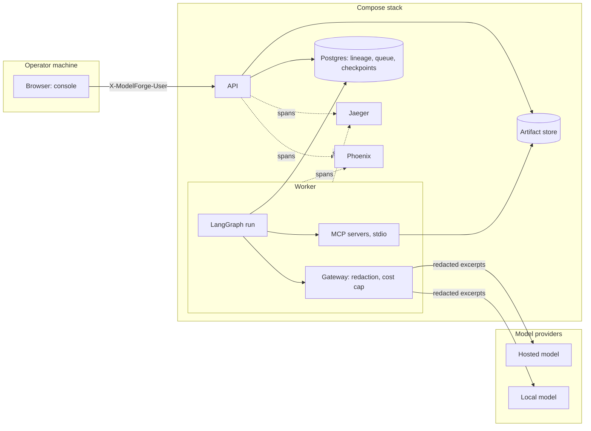

# Threat model

This document names ModelForge's trust boundaries, the threats the design addresses with the mitigation as built and the test or contract that proves it, the exceptions the API and console introduced, and the risks that remain. ModelForge is a reference implementation, not a production system; this model assumes a single trusted operator running the stack on their own machine, and the [design memo](design-memo.md#what-a-bank-would-have-to-change-before-use) lists what a deployment would have to add.

## Trust boundaries

Four boundaries matter:

- **Browser to API.** The console and any HTTP client reach the API on the operator's machine. Requests carry an identity header, not a credential (see [exceptions](#exceptions-introduced-by-sp5)). The API enqueues work and serves reads; it never calls a model and never runs a node.
- **Worker to MCP servers.** The worker launches each MCP server as a stdio subprocess with an allowlisted environment (paths, locale and the four directory settings, never the database URL or a provider credential), proven by `test_stdio_servers_get_an_allowlisted_environment` in [`packages/orchestrator/tests/test_tools.py`](../packages/orchestrator/tests/test_tools.py). The test suites also run the same servers in process through the SDK's in-memory transport.
- **Gateway to providers.** The only path from the system to a model. Whatever crosses it has passed the excerpt projection and the redaction scan, and is recorded as an `llm_calls` row with a stored raw response. With a local profile, nothing leaves the machine.
- **Stack to collectors.** Spans go to Jaeger and Phoenix over OTLP. By default they carry identifiers, timings, token counts and costs, never prompt or completion text.

Postgres and the artifact store are inside the boundary and trusted for availability; tampering with them is detected rather than prevented (threat 5).

## Threats and mitigations

The ten threats are the ones the umbrella design named. "Proof" is a test file and test name, a contract in [`pyproject.toml`](../pyproject.toml), or a pinned file.

| # | Threat | Mitigation as built | Proof |
| --- | --- | --- | --- |
| 1 | Prompt injection through column names, values or brief text | The model never sees rows: agents receive per-kind projections that turn row-level fields into counts. Features are renamed `f_<n>` at load and the original names are added to the redaction scan, so a prompt carrying one is refused. The brief is passed inside a fenced data block and the system prompt says any instruction inside it is ignored; the scope agent's output must keep the brief's identity fields and policy limits or it is rejected. No agent holds a callable tool: agents return typed objects and at most a list of knowledge queries, which the orchestrator runs against the read-only knowledge server. The challenger never reads the brief. | Structural, not an eval case (see [residual risks](#residual-risks)). Column renaming: `packages/core/modelforge_core/datasets/base.py`; original names in the scan: `restricted_terms` in `packages/orchestrator/modelforge_orchestrator/nodes/document.py`; brief never reaches the challenger: [`test_challenger_isolation.py`](../packages/orchestrator/tests/test_challenger_isolation.py) |
| 2 | Exfiltration of data to an external model | Aggregates only, through the excerpt projection. The gateway scans every message for e-mail addresses, IBAN-like tokens, long digit runs, original column names and the brief's `restricted_terms`, and refuses rather than masks. Local profiles keep all traffic on the machine. No package imports a provider SDK or an HTTP client directly; only the gateway's provider module imports the LangChain provider integrations. | [`packages/gateway/tests/test_redaction.py`](../packages/gateway/tests/test_redaction.py); `test_complete_refuses_on_redaction_hit_and_sends_nothing` in [`packages/gateway/tests/test_gateway.py`](../packages/gateway/tests/test_gateway.py); contracts "no direct LLM provider SDKs or HTTP clients" and "only the gateway providers import LangChain integrations" in [`pyproject.toml`](../pyproject.toml) |
| 3 | Tool misuse or parameter tampering | Tool inputs are strict Pydantic models that forbid unknown fields; tools take artifact ids, not paths, and check the kind of the artifact they are given; errors are typed payloads. Tool calls are made by deterministic nodes with parameters from the approved plan and artifact ids, never from model text. Each tool's schema is snapshotted. | [`packages/mcp/tests/test_contracts.py`](../packages/mcp/tests/test_contracts.py) (schema snapshots and golden hashes); [`packages/mcp/tests/test_common.py`](../packages/mcp/tests/test_common.py) (typed errors, unknown adapter is invalid input); `test_score_rejects_non_model_artifact` in [`packages/mcp/tests/test_credit_modeling.py`](../packages/mcp/tests/test_credit_modeling.py) |
| 4 | Unsafe deserialization | No pickle anywhere: the champion is a JSON scorecard, the challenger model LightGBM native text, tables Parquet, reports JSON. | [`packages/core/tests/test_no_pickle.py`](../packages/core/tests/test_no_pickle.py) |
| 5 | Audit tampering | Events are append-only and hash-chained; artifacts are content-addressed by SHA-256; the sealed manifest pins every reference and anchors the chain's head. `verify` walks the chain, re-hashes every artifact and checks the anchor. | `test_verify_run_reports_tampered_artifact_and_event` and `test_verify_run_requires_manifest_head_hash_in_chain` in [`packages/lineage/tests/test_verify.py`](../packages/lineage/tests/test_verify.py); end to end in [`packages/orchestrator/tests/test_integration.py`](../packages/orchestrator/tests/test_integration.py) |
| 6 | Challenger contamination by developer reasoning | The challenger's context is built in one module from lineage by artifact id: the rendered document, the validation excerpt, the recorded plan and its own passages. It has its own routing purpose, so it can be routed to a separate model. | [`packages/orchestrator/tests/test_challenger_isolation.py`](../packages/orchestrator/tests/test_challenger_isolation.py) (sentinel strings in every developer-side artifact never reach a challenge call) |
| 7 | Cost runaway | A per-run cost cap checked by the gateway before every attempt, schema retries included; a breach parks the run before sending and a human resumes it with a higher cap. Bounded model-gate adjustments and review rounds; tool and model request timeouts. | `test_complete_parks_on_cost_cap_before_sending` and `test_cost_cap_is_checked_before_every_attempt` in [`packages/gateway/tests/test_gateway.py`](../packages/gateway/tests/test_gateway.py); `test_resume_from_cost_cap_park` in [`packages/api/tests/test_writes.py`](../packages/api/tests/test_writes.py); [`packages/orchestrator/tests/test_loop.py`](../packages/orchestrator/tests/test_loop.py) |
| 8 | Approval bypass | Gates are passed only through the approvals path; `resume` is refused at a gate. `record_approval` refuses the requester at the model and sign-off gates, a decision for the wrong gate, a second queued decision, and an unconditional sign-off while a critical or high finding is open. Writes require a well-formed identity header and, with a role map, the right role; the actor is recorded. | `test_four_eyes_on_model_and_signoff` and `test_signoff_approve_blocked_by_open_high_finding` in [`packages/lineage/tests/test_approvals.py`](../packages/lineage/tests/test_approvals.py); `test_gates_through_the_api`, `test_blocking_findings_refusal` in [`packages/api/tests/test_writes.py`](../packages/api/tests/test_writes.py); `test_identity_header_rules` and `test_role_map_enforced` in [`packages/api/tests/test_identity.py`](../packages/api/tests/test_identity.py) |
| 9 | Secrets exposure | Credentials come from the environment only. `GET /api/v1/config` reports no provider key and strips user names, passwords and query tokens from every URL it shows (the collector endpoints and the trace viewers). MCP subprocesses receive an allowlisted environment without the database URL or provider keys. Model calls are recorded by provider, model and prompt hash, never with credentials. | `test_config_redacts_credentials_and_reports_console_modes` in [`packages/api/tests/test_system.py`](../packages/api/tests/test_system.py); `test_stdio_servers_get_an_allowlisted_environment` in [`packages/orchestrator/tests/test_tools.py`](../packages/orchestrator/tests/test_tools.py) |
| 10 | Supply chain | Python dependencies locked in [`uv.lock`](../uv.lock) and installed with `--frozen` in the [`Dockerfile`](../Dockerfile); datasets pinned by SHA-256 and verified on download, with a corrupt cached file refetched; service images pinned by tag in [`docker-compose.yml`](../docker-compose.yml) and the Dockerfile; console dependencies installed from the lockfile with `npm ci`. | [`packages/core/tests/test_download.py`](../packages/core/tests/test_download.py) (`test_fetch_rejects_bad_hash_and_leaves_no_file`, `test_fetch_redownloads_when_cached_file_is_corrupt`) |

## Exceptions introduced by SP5

The API and console sub-project added three exceptions to the model above. Each is deliberate and documented where it is configured.

- **The identity header is identity, not authentication.** `X-ModelForge-User` names the actor of every write and is validated for shape (`test_identity_header_rules` in [`packages/api/tests/test_identity.py`](../packages/api/tests/test_identity.py)), but it is not a credential: anyone who can reach the API can send any name. The four-eyes rule and the role map are recorded and enforced against the name sent, so they are only as strong as the network boundary around the API.
- **`MODELFORGE_TRACE_CONTENT=1` sends prompts and completions to the configured collectors.** With it set, the gateway adds the system text, the request messages and the completion to each model span, and those spans go to every configured collector (Jaeger and Phoenix in Compose). It is meant for local collectors only; the gateway logs a warning when it is built with the setting on, and `/config` reports it. Off, spans carry no content and errors carry only their type and code (`test_llm_span_per_attempt_without_content` and `test_llm_span_carries_content_when_enabled` in [`packages/gateway/tests/test_gateway_tracing.py`](../packages/gateway/tests/test_gateway_tracing.py)).
- **Model-derived HTML is served from the console's origin.** The rendered development document and stored artifact bodies are served by the API, on the same origin as the console. The renderer disables raw HTML in Markdown, and every such response carries `Content-Security-Policy: sandbox` and `X-Content-Type-Options: nosniff`, so a document cannot run script with the console's origin or be sniffed into another type ([`packages/api/tests/test_runs_read.py`](../packages/api/tests/test_runs_read.py) checks the headers).

## Residual risks

Open:

- **No worker lease.** The queue claim is a row lock with the worker's id, with no heartbeat or expiry. A worker that dies or is killed mid-node leaves its run `running`; the console shows it as running indefinitely, and abort is refused while a run is `running`. This happened in SP6: a local-model run whose harness process was terminated was left `running` and is recorded as such. Recovery is by hand.
- **The global event stream's window.** Event ids come from a sequence, but commits are serialised only per run, so across runs a lower id can commit after a higher one was read. The per-run stream is exact; the global stream re-reads a trailing window of 200 ids (`WINDOW` in `packages/api/modelforge_api/sse.py`) and skips ids it has delivered. An event that commits more than that window behind the cursor, or at or below the id a stream started after, is missed, and a reconnect may repeat events. The console only invalidates queries on the global stream, so a duplicate is harmless and a miss is corrected by the next poll; `test_event_stream_window_delivers_out_of_order_commits_once` in [`packages/api/tests/test_sse.py`](../packages/api/tests/test_sse.py) covers the window.
- **No prompt-injection eval case.** The umbrella design promised an eval case with a poisoned column name and brief. It was not built. The structural controls in threat 1 stand, but no test plants an injection and measures the outcome.
- **Images pinned by tag, not digest.** The Jaeger, Phoenix and console build images carry exact version tags; the Python and Postgres base images carry minor or major tags (`python:3.12-slim`, `pgvector/pgvector:pg16`). None is pinned by digest.
- **Single-operator assumption.** The API has no transport security and no rate limiting, and Phoenix runs with authentication disabled in Compose. All are acceptable on a single machine and none is acceptable on a shared network.

Closed in SP6:

- **Abort lock order.** API and CLI `abort` released the queue row before locking the run row, the reverse of `resume`'s order, which could deadlock against a concurrent resume. Abort now transitions the run (locking its row) before releasing the queue row. Proof: `test_abort_locks_the_run_before_releasing_the_queue` in [`packages/api/tests/test_writes.py`](../packages/api/tests/test_writes.py) and `test_abort_transitions_before_release` in [`packages/orchestrator/tests/test_cli.py`](../packages/orchestrator/tests/test_cli.py).
- **Missing replay report.** A replay whose report artifact was missing from the store made `GET /runs/{id}` and the replays list return 404. The replay is now listed with `report_missing: true` and the run reads normally. Proof: `test_missing_replay_report_is_flagged_not_404` in [`packages/api/tests/test_runs_read.py`](../packages/api/tests/test_runs_read.py).
