# Walkthrough

This page follows one demo run through the console, one screenshot per step, from an empty run list to a sealed and replayed run. Under each screenshot is the API call that returns the same thing, so every screen can be checked without the console. ModelForge is a reference implementation, not a production system.

The screenshots come from the scripted recording (`make demo-record`) on the `fake` profile, which replaces the language model with scripted replies so the run is free and repeatable. Two identities take part: `alice` submits the run and decides the scope gate, and `bob` decides the model and sign-off gates, because the requester may not decide those two. The console sends the name typed in its Identity box as the `X-ModelForge-User` header; with no `MODELFORGE_USERS` role map set, as in the demo stack, every name holds every role.

The `curl` lines assume the stack from `make demo` on `localhost:8000` and a shell variable for the run:

```bash
API=http://localhost:8000/api/v1
RUN=run_...   # the id printed by make demo, or returned by step 2
```

## 1. The run list

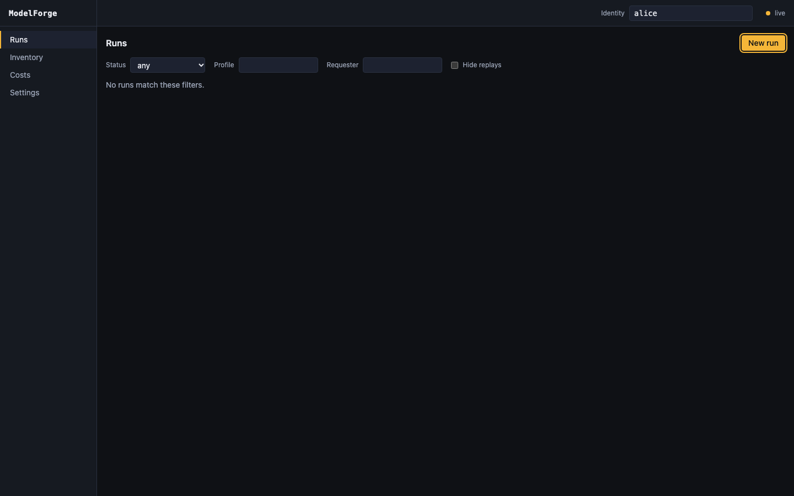

The Runs page lists runs newest first and filters them by status, profile and requester; "Hide replays" drops the replay runs a sealed run spawns. The Identity box at the top right is the acting identity for every write the console makes, and the `live` dot shows the console is following the global event stream.

```bash
curl -s "$API/runs?limit=50&replays=exclude" -H 'X-ModelForge-User: alice'
```

## 2. A new run

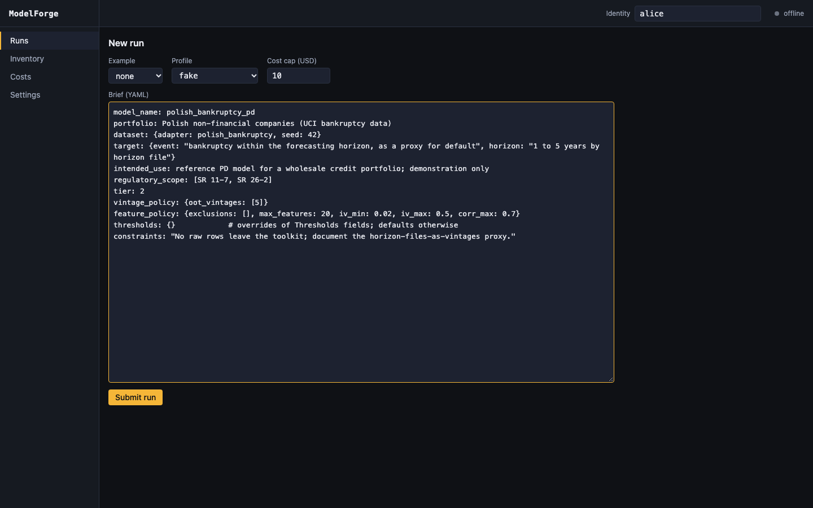

The form takes a profile, a cost cap and the brief as YAML; this is `examples/briefs/polish-pd.yaml`, the brief `make demo` submits. Submitting creates the run and enqueues its start: the API records lineage and the worker executes, so the request returns at once.

```bash
curl -s -X POST "$API/runs?profile=fake" \
  -H 'X-ModelForge-User: alice' -H 'Content-Type: application/yaml' \
  --data-binary @examples/briefs/polish-pd.yaml
```

The response is `201` with the run record, whose `id` is the run id.

## 3. The scope gate

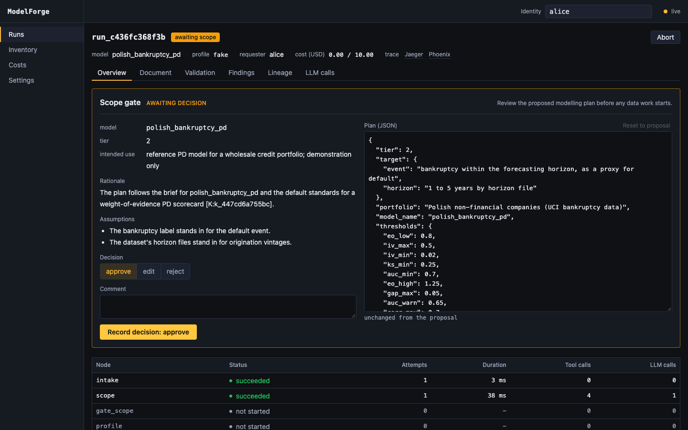

The `scope` node has read the brief and proposed a modelling plan, and the run stops at `awaiting scope` before any data is touched. The panel shows the plan's rationale with its citation into the knowledge base, the assumptions it makes, and the plan itself as editable JSON; the decisions are `approve`, `edit` (send a changed plan) and `reject`.

```bash
curl -s "$API/runs/$RUN" -H 'X-ModelForge-User: alice'
```

The run detail carries `status` (`awaiting_scope`), the open gate with its summary, the counters, the cost summary and the trace links.

## 4. Scope approved

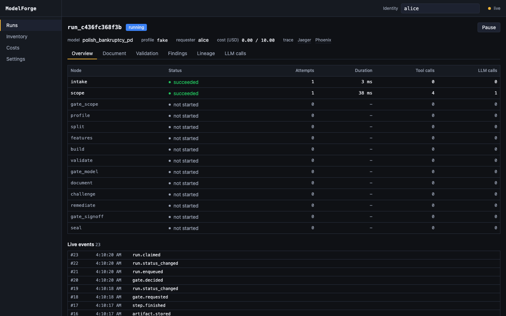

`alice` records `approve`, and the run goes back to `running`. The node table fills in as the deterministic steps run, and the live event list shows `gate.decided`, `run.enqueued` and `run.claimed` as the worker picks the run up again.

```bash
curl -s -X POST "$API/runs/$RUN/approvals" \
  -H 'X-ModelForge-User: alice' -H 'Content-Type: application/json' \
  -d '{"gate": "scope", "decision": "approve"}'
```

The response is `202` with the approval record. The same events arrive as server-sent events, each with an `id:` line and the event record as JSON on its `data:` line:

```bash
curl -N "$API/runs/$RUN/events/stream"
```

## 5. The model gate

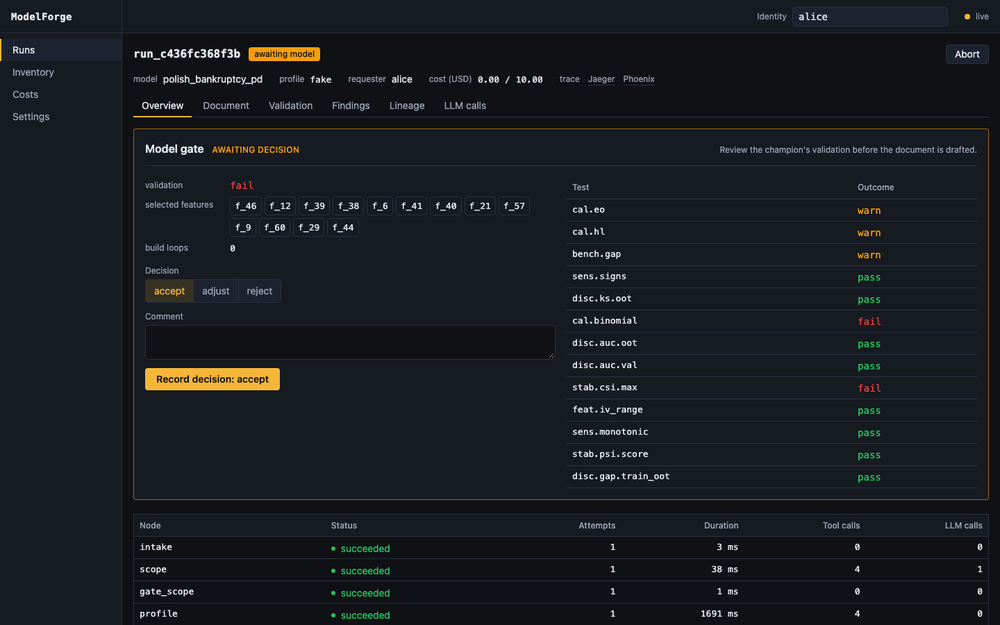

Profiling, splitting, binning, fitting and validation have run, and the run stops at `awaiting model` before any document is drafted. The panel shows the validation outcome, the selected features, the build loops so far and each validation test with its outcome; failing tests here are for the reviewer to weigh, not a block, and the challenger will hold the document to them. The decisions are `accept`, `adjust` (go back to features or build with a changed plan) and `reject`.

```bash
curl -s "$API/runs/$RUN/validation" -H 'X-ModelForge-User: alice'
```

## 6. Four eyes

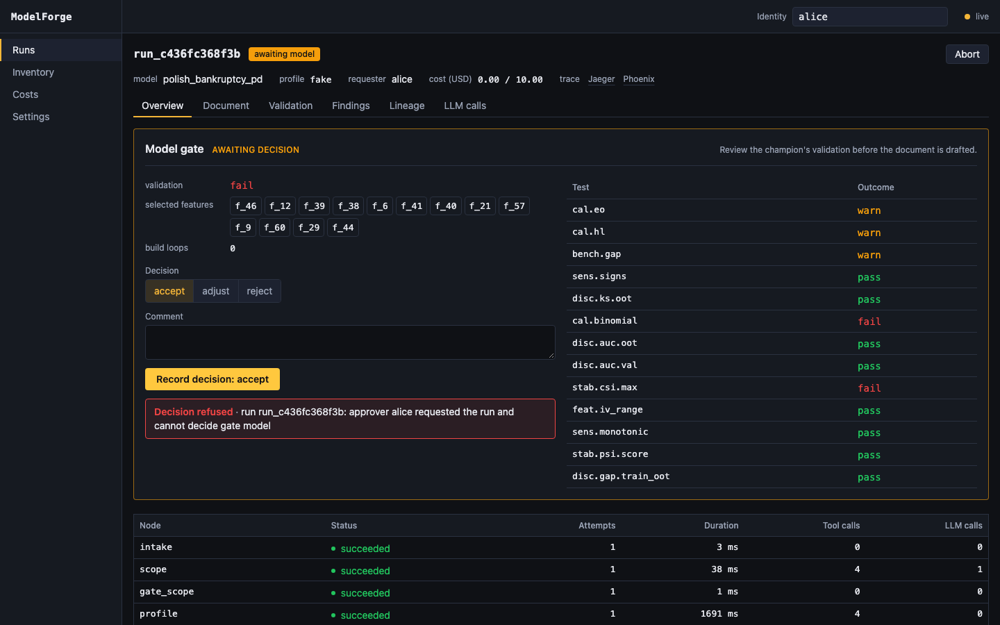

`alice` tries to accept her own model and the decision is refused: the requester of a run may not decide its model or sign-off gate. The refusal comes from the lineage store, not the console, so the API refuses it the same way.

```bash
curl -s -X POST "$API/runs/$RUN/approvals" \
  -H 'X-ModelForge-User: alice' -H 'Content-Type: application/json' \
  -d '{"gate": "model", "decision": "accept"}'
```

The response is `409` with the API's one error shape:

```json
{"error": {"kind": "approval", "message": "run run_...: approver alice requested the run and cannot decide gate model"}}
```

## 7. Model accepted

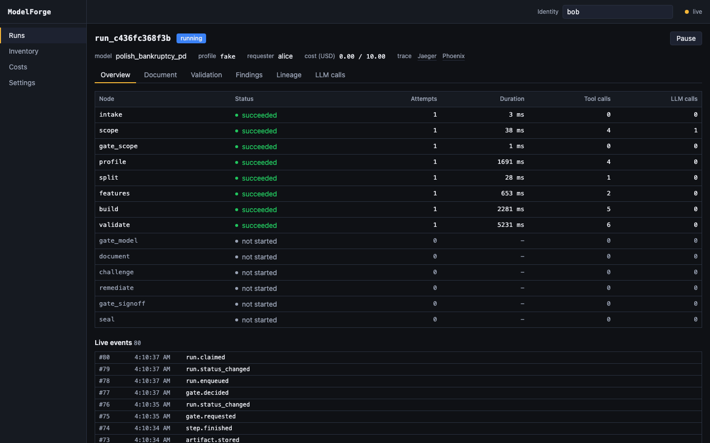

With the identity switched to `bob`, the same decision is recorded and the run moves on to the document, the challenger's review and remediation. Every node up to `validate` has succeeded; the rest are still to run.

```bash
curl -s -X POST "$API/runs/$RUN/approvals" \
  -H 'X-ModelForge-User: bob' -H 'Content-Type: application/json' \
  -d '{"gate": "model", "decision": "accept"}'
```

## 8. The document

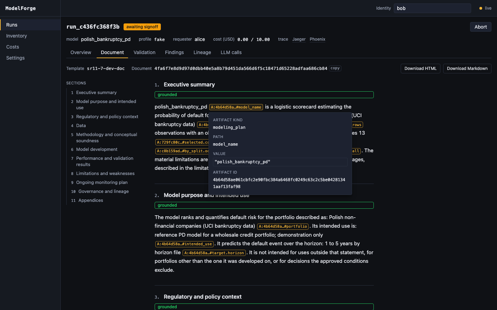

Once the run parks at `awaiting signoff`, the Document tab holds the development document section by section, each marked `grounded` when every number in it resolves to an artifact. Hovering a citation chip opens what it points at: the artifact kind, the path inside it, the value and the artifact id. The rendered HTML and Markdown are one click away.

```bash
curl -s "$API/runs/$RUN/document?format=sections" -H 'X-ModelForge-User: bob'
```

`format=html` and `format=md` return the stored renderings instead of the sections.

## 9. The findings

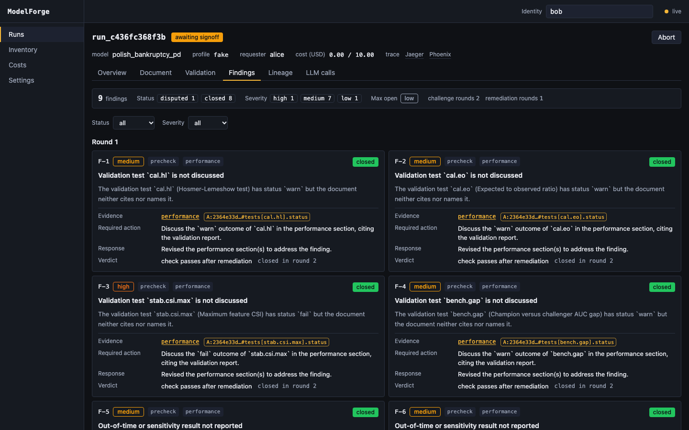

The challenger is an independent reviewer inside the run: it did not build the model or write the document. Each finding carries its severity, its source (a deterministic pre-check or the review), its evidence citation, the required action, the remediation response and the verdict. The summary bar counts findings by status and severity and shows the highest severity still open, which is what the sign-off gate checks.

```bash
curl -s "$API/runs/$RUN/findings" -H 'X-ModelForge-User: bob'
```

## 10. Lineage and the verified chain

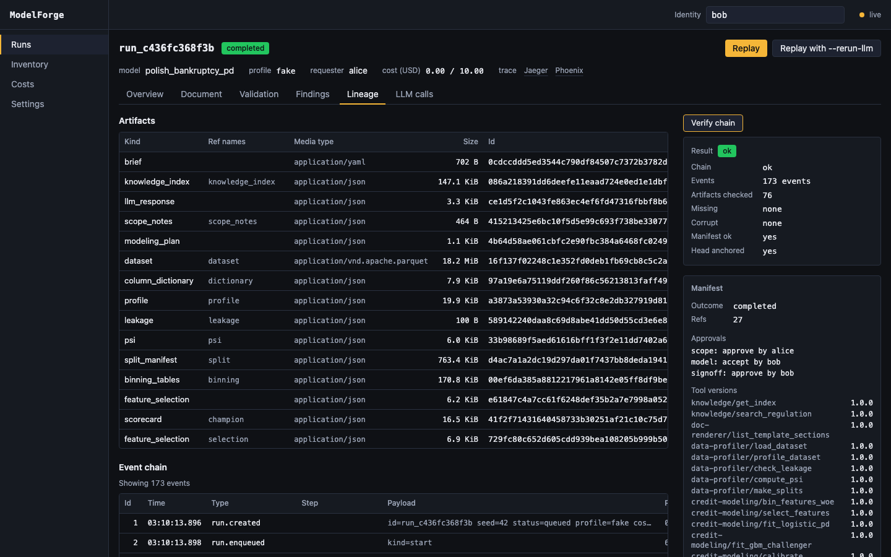

This step is reachable only once the run is sealed, so the recording took it after sign-off (step 12). The Lineage tab lists every artifact with its content hash, the hash-chained event log and the sealed manifest with the approvals and tool versions; `Verify chain` re-checks the event chain, every artifact's hash and the manifest, and shows `ok`.

```bash
curl -s "$API/runs/$RUN/verify" -H 'X-ModelForge-User: bob'
curl -s "$API/runs/$RUN/manifest" -H 'X-ModelForge-User: bob'
```

## 11. Costs

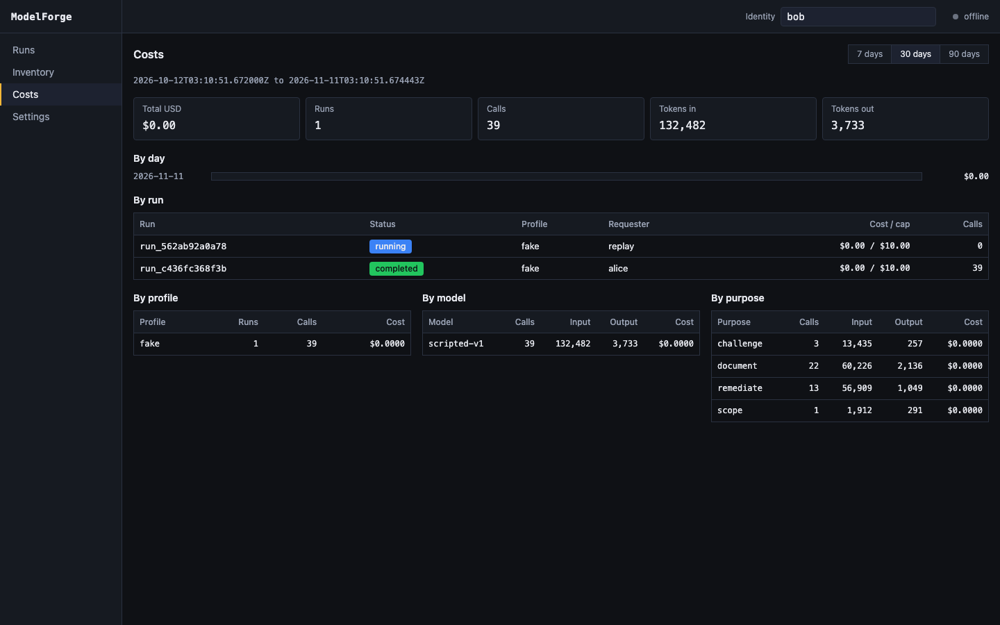

The Costs page sums the recorded model calls over a window, by day, run, profile, model and purpose. On the `fake` profile every call is priced at zero, but the calls and tokens are still counted, so the breakdown by purpose shows where a hosted model's spend would go.

```bash
curl -s "$API/costs" -H 'X-ModelForge-User: bob'
```

Without `since` and `until` the window is the last 30 days.

## 12. Sign-off

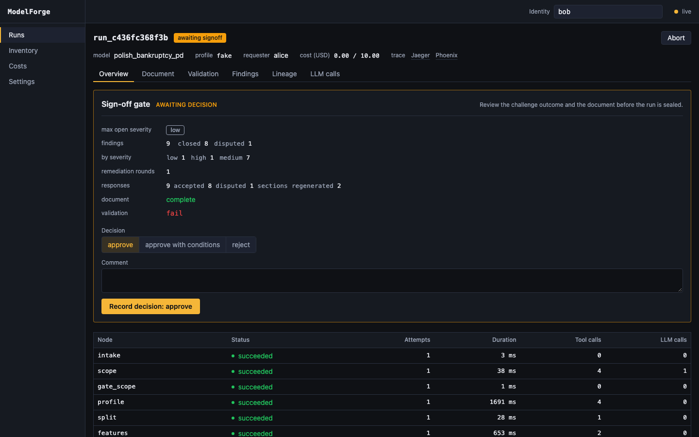

The sign-off gate summarises the review: the highest open severity, the findings by status and severity, the remediation rounds and responses, whether the document is complete and the validation outcome. The decisions are `approve`, `approve_with_conditions` (with at least one condition) and `reject`; a plain `approve` is refused while a critical or high finding is open or disputed, and here the highest open severity is low. `bob` approves.

```bash
curl -s -X POST "$API/runs/$RUN/approvals" \
  -H 'X-ModelForge-User: bob' -H 'Content-Type: application/json' \
  -d '{"gate": "signoff", "decision": "approve"}'
```

A sign-off refused for blocking findings is a `409` of kind `approval` whose error also lists the blocking findings.

## 13. Sealed and reproduced

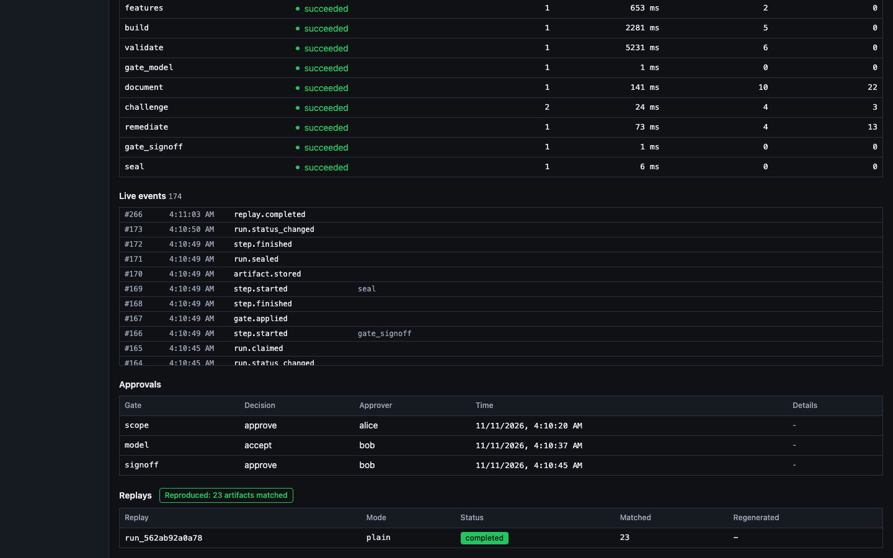

The run is `completed`: the `seal` node wrote the manifest, and the approvals table records who decided each gate and when. The demo stack replays every completed run automatically: a plain replay re-executes the deterministic steps and copies the original's model outputs instead of calling a model, and the badge `Reproduced: N artifacts matched` means the replay's artifacts matched the original's hashes.

```bash
curl -s "$API/runs/$RUN/replays" -H 'X-ModelForge-User: bob'
```

Each replay comes back as `{run, report}`, the report `null` until the replay seals. A replay can also be requested by an approver with `POST /api/v1/runs/{id}/replay`.

## From a fresh clone

`make fresh-clone-test` checks the "clone and run one command" path: it clones the public repository into a temporary directory, runs `make demo` there on a Compose project and Postgres port of its own, waits until the demo run reaches its first gate, and tears the stack and the clone down. On an Apple-silicon laptop it printed:

```text
fresh-clone: awaiting_scope after 25 s
```

That run reused Docker's build cache and base images from earlier builds on the same machine, so it measures the clone, the stack start-up and the run to its first gate, not a cold image build; on a machine that has never built the images, the first `make demo` also pulls the base images and builds the two application images. The full set of targets is in [Commands](reference/commands.md), and the stack in [Compose](reference/compose.md).

[Back to the README](../README.md)
