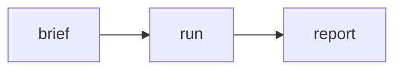

# Fixture project

A small tree that passes every documentation check.

## Links

Read [the guide](docs/a.md), jump to [its second section](docs/a.md#section-two-setup),
or back to [the links](#links). See [the site](https://example.com) too.

## Results

<!-- results:fixture -->
| run | cost (USD) |
|-----|-----------:|
| run_000000000001 | 1.00 |
<!-- /results:fixture -->

## Diagram

